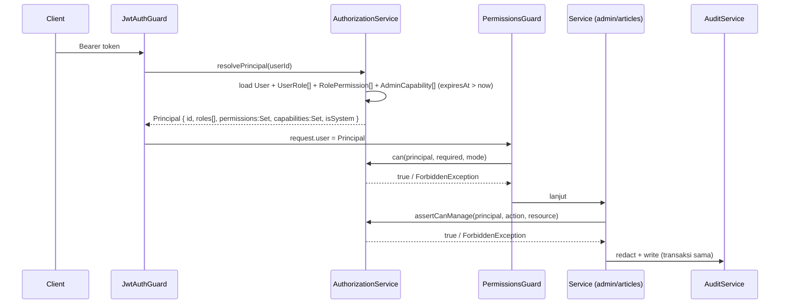

# Phase 01 — Authorization Architecture (final revision)

## 1. Prinsip

1. Backend adalah **satu-satunya** otoritas; frontend hanya merender hasil keputusan backend.
2. Permission = metadata. Membuat baris `Permission` **tidak pernah** membuat endpoint/fitur.
3. Semua keputusan akses lewat satu komponen: `AuthorizationService`.
4. Role/permission dibaca dari database per request → perubahan langsung berlaku tanpa re-login.
5. Default deny, **fail closed**.

## 2. Komponen

| Komponen | Status | Tanggung jawab |
|---|---|---|
| `AuthModule` / `JwtAuthGuard` | Existing, dipertahankan | Verifikasi JWT, memuat user. |
| `PrismaModule` (@Global) | Existing | Akses database. |
| `AuthorizationModule` | **Baru** | `AuthorizationService`, policy registry, guard administratif. |
| `PermissionsGuard` | Existing, dipakai ulang | Membaca `@RequirePermissions` dan bertanya ke `AuthorizationService`. |
| `@RequirePermissions` / `@RequireAnyPermissions` | Existing / **baru** | ALL-of / ANY-of di handler. |
| `AuditService` | **Baru** | Meredaksi payload lalu menulis `AuditLog` dalam transaksi. |

`@RequirePermissions` tetap ALL-of agar perilaku existing tidak berubah.

## 3. Alur request



```ts
type Principal = {
  id: string;
  email: string;
  username: string;
  roles: { id: string; name: string; isSystem: boolean }[];
  permissions: Set<string>;   // union dari semua RolePermission
  capabilities: Set<string>;  // hanya yang belum expired
  isSystem: boolean;
};
```

## 4. Resolusi multi-role

```
resolvePrincipal(userId):
  user = findUnique(id, include: roles.role.permissions.permission, capabilities.permission)
  if !user || !user.isActive -> UnauthorizedException
  permissions = union(r.permissions.map(p => p.permission.key) for r in user.roles)
  capabilities = union(c.permission.key for c in user.capabilities where c.expiresAt > now())
  isSystem     = user.roles.some(r => r.role.isSystem)
  return { ..., permissions, capabilities, isSystem }
```

- User tanpa role → `permissions = ∅` → semua endpoint terproteksi ditolak.
- Tidak ada prioritas role; role yang dicabut langsung hilang pada request berikutnya.

## 5. Permission key & legacy alias

**Format baru `action:resource`** dipakai di seluruh kode, seed, dan API setelah migrasi:

| Key lama | Key baru |
|---|---|
| `article.read` | `read:article` |
| `article.create` | `create:article` |
| `article.update` | `update:article` |
| `article.delete` | `delete:article` |
| `user.manage` | `manage:user` |

Permission baru mengikuti konvensi yang sama: `view:menu`, `create:user`, `update:role`, `read:audit`, `grant:admin`.

**Penugasan otomatis:** `POST /admin/permissions` harus, **dalam satu transaksi**, membuat baris `Permission` **dan** menambahkannya ke role `superadmin` lewat `RolePermission`. Ini adalah satu-satunya jalur API yang boleh menambah permission ke role sistem. Endpoint API lain tidak boleh menghapus atau mengubah permission yang melekat pada role sistem (§7.1); `DELETE /admin/permissions/:id` ditolak jika permission masih dipakai, termasuk oleh `superadmin`.

**Legacy aggregate:** `manage:user` tetap di-perlakukan sebagai alias agregat untuk seluruh aksi administrasi di `AuthorizationService` selama transisi. Aturan ini hanya di kode, bukan baris DB tambahan. **Alias ini tidak boleh dijadikan dasar pemberian delegasi** (aturan 2 di §7.2).

Mode pemeriksaan:
| Mode | Semantics | Pemakaian |
|---|---|---|
| `all` (default) | Semua permission harus ada | `@RequirePermissions('read:user', 'read:role')` |
| `any` | Minimal satu ada | `@RequireAnyPermissions('read:article', 'update:article')` |

## 6. Filter menu (backend)

```
visibleMenus(principal):
  aktif = Menu.where(isActive = true).include(permissions)
  visible = aktif.filter(m =>
      m.permissions.length === 0 ?
        true :                                   // menu publik untuk user terautentikasi
        m.permissions.some(p => principal.permissions.has(p.key))   // ANY-of (O1)
  )
  tree = buildTree(visible)                    // urut by order, lalu name
  // anak dari parent yang tidak visible ikut disembunyikan
  return tree
```

Dikirim lewat `GET /auth/me` sebagai `menus`. Frontend dilarang menganggap penyembunyian menu sebagai proteksi.

**Siklus `Menu.parentId` dilarang keras.** Service wajib memvalidasi graph saat create/update dan menolak (`400`) jika menu menjadi induk dari induknya sendiri, langsung maupun transitif. `onDelete: SetNull` hanya mengatasi hapus parent, bukan siklus.

## 7. Delegated administration

### 7.1 Proteksi `superadmin` — tiga ranah

| Ranah | Operasi yang dilarang |
|---|---|
| **Konfigurasi role** | Rename, ubah `description`, ubah `isSystem`, hapus role. Flag `isSystem` hanya dari seed/migrasi. |
| **Assignment user-role** | Memberi/mencabut role `superadmin`; mengubah/menghapus akun pemegangnya. |
| **Manajemen permission** | `PUT /admin/roles/:id/permissions` pada role sistem — dilarang agar `grant:admin`, `manage:user`, dll. tidak bisa dicabut. |

Invariant: minimal satu user `superadmin` selalu ada.

**Bootstrap:** role `superadmin` (`isSystem = true`) dan akun pertama dibuat oleh seed/migrasi memakai `ADMIN_EMAIL` / `ADMIN_PASSWORD`, dengan seluruh permission (termasuk `grant:admin`, `manage:user`) melekat. Bootstrap tidak bisa dilakukan lewat API.

**Recovery (jika akses superadmin hilang):** karena API tidak bisa memberi/mencabut role `superadmin` dan tidak bisa menghapus akun pemegangnya, pemulihan adalah prosedur break-glass yang diaudit:
1. Hentikan aplikasi / freeze write.
2. Verifikasi identitas operator dan minta approval tertulis.
3. Pulihkan dari backup **atau** jalankan skrip operasional terkontrol yang: (a) memastikan role `superadmin` ada & `isSystem = true`, (b) membuat/mengaktifkan akun superadmin dengan kredensial baru, (c) memastikan seluruh permission melekat pada role tersebut.
4. Rotasi kredensial dan `JWT_SECRET`, lalu verifikasi login + `/auth/me`.
5. Catat kejadian ke `AuditLog` (actor, alasan, before/after) dan simpan bukti approval.

Skrip recovery bukan fitur Phase 02; Phase 01 hanya mendokumentasikan prosedurnya.

### 7.2 Aturan delegasi (13 aturan, fail closed)

1. Actor harus memiliki permission untuk aksi yang dilakukan.
2. Actor harus memiliki **capability eksplisit** untuk permission yang diberikan. Permission yang hanya diperoleh lewat alias `manage:user` **tidak dihitung**.
3. `grant:admin` **tidak bisa didelegasikan**. `create:delegation` hanya bisa diberikan oleh `superadmin` dan **tidak boleh diteruskan lagi** (maksimal satu level).
4. Permission `isProtected = true` hanya bisa diberikan oleh `superadmin`.
5. Pemeriksaan subset berlaku juga saat **membuat role** dengan `permissionKeys[]` (`POST /admin/roles`): semua key harus ⊆ capability actor **dan** ⊆ permission actor (kecuali `superadmin`). Hal yang sama berlaku saat memberi role ke user. Mencegah eskalasi lewat role baru yang menyimpan permission di luar kewenangan actor.
6. Actor tidak boleh mengubah permission dari **role yang ia pegang sendiri**.
7. Actor tidak boleh mengubah/menghapus/memberi capability kepada **dirinya sendiri** atau **grantor-nya**.
8. Graf delegasi harus **asiklik**, langsung maupun transitif.
9. Capability baru grantee ⊆ capability actor (batas transitif), dan `parentCapabilityId`-nya wajib menunjuk ke capability sumber yang masih berlaku milik actor (atau `null` hanya untuk root dari `superadmin`).
10. **Invalidasi rantai via lineage**: capability grantor yang dicabut/expired → seluruh descendant ikut dicabut. Penelusuran & mekanismenya di §7.3.
11. `expiresAt` **wajib** di masa depan, maks. **90 hari**, tanpa pengecualian.
12. Setiap create/revoke delegasi ditulis ke `AuditLog` dalam transaksi yang sama.
13. Jika ada pemeriksaan gagal → `403 Forbidden`, tanpa perubahan sebagian.

Contoh: admin `finance` memiliki `create:user` + capability `create:user` → ia boleh membuat user, tetapi tidak boleh memberi `delete:role`, menyentuh `superadmin`, mengubah role sendiri, mendelegasikan `grant:admin`, atau membuat delegasi > 90 hari.

### 7.3 Penelusuran & invalidasi lineage

- Setiap `AdminCapability` menyimpan **`parentCapabilityId`** (self-FK ke capability sumber). `null` = **root**, diberikan langsung oleh `superadmin`.
- **Trace:** `AuthorizationService` menaikkan rantai `capability → parentCapability → … → root`. Jika **ada** ancestor yang `expiresAt <= now()`, sudah dicabut, atau melanggar aturan subset, maka seluruh capability di bawahnya dianggap **tidak berlaku** (fail closed) walaupun barisnya masih ada.
- **Invalidasi dua lapis:** (1) `DELETE /admin/delegations/:id` pada ancestor dan penghapusan baris expired oleh job cleanup menghapus ancestor; karena self-FK memakai `onDelete: Cascade`, descendant ikut terhapus. (2) Pengecekan rantai di `resolvePrincipal` segera menonaktifkan descendant sebelum job cleanup berjalan.
- **Siklus dilarang:** `parentCapabilityId` tidak boleh membentuk rantai melingkar; create delegasi menolak (`403`) jika grantee adalah ancestor dari actor, langsung maupun transitif (aturan 8).
- Audit create/revoke mencatat `parentCapabilityId`, grantor, grantee, dan `invalidatedDescendantIds` (daftar descendant yang terkena invalidasi).

## 8. Permission vs endpoint (drift)

```ts
// contoh — key format action:resource
export const POLICIES = {
  'GET /admin/users': { permission: 'read:user', mode: 'all' },
  'POST /admin/roles': { permission: 'create:role', mode: 'all' },
  'GET /articles': { permission: 'read:article', mode: 'all' },
} as const;
```

`GET /admin/permissions/drift` mengembalikan `orphan` (permission tanpa endpoint) dan `unregistered` (endpoint tanpa permission di DB). Endpoint ini **hanya melapor**, tidak membuat endpoint/permission.

**Setiap endpoint terproteksi wajib terdaftar di policy registry.** Tidak boleh ada `@RequirePermissions` / `@RequireAnyPermissions` yang tidak punya entri `POLICIES`. Temuan `unregistered` diperlakukan sebagai **pelanggaran** yang harus dibereskan sebelum deploy, bukan sekadar informasi. Permission `orphan` boleh ada sebagai metadata, tetapi tidak boleh dianggap sebagai endpoint aktif.

## 9. Audit

Aksi wajib tercatat: CRUD user/role/permission/menu, assign/revoke role, set permission, create/revoke delegation, login (disarankan). Retention **365 hari** dan **redaction whitelist** di dokumen 07 §5; `before/after` tidak pernah berisi password/token.

**Pembeda nama yang wajib dijaga:** permission key memakai **`action:resource`** (mis. `create:user`, `read:article`), sedangkan **`AuditLog.action` memakai `resource.action`** (mis. `user.create`, `role.permissions.update`). Keduanya bukan hal yang sama dan tidak boleh disamakan atau dipakai bergantian; `AuditLog.action` **bukan** permission key.

## 10. Caching

Tidak ada cache permission di Phase 02 — database dibaca per request agar pencabutan langsung berlaku. Invalidasi eksplisit dipertimbangkan jika performa bermasalah.

## 11. Open items

- **O1** ANY-of vs ALL-of untuk menu (default ANY-of).
- **O4** Daftar permission ERP mentor belum tersedia; policy registry diperluas setelah daftar resmi diterima.
