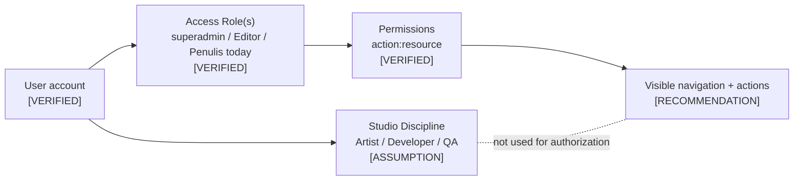
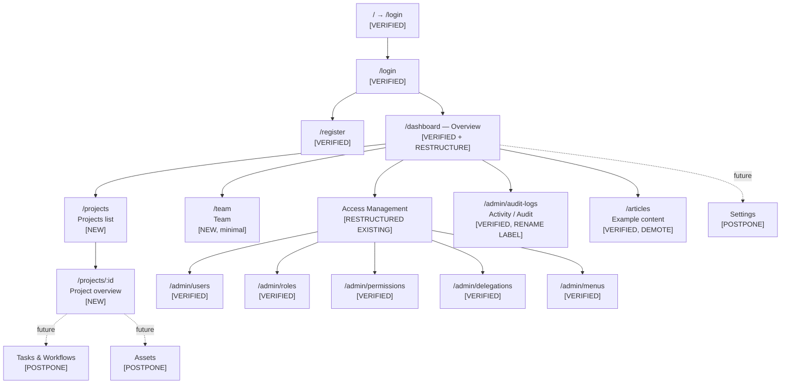
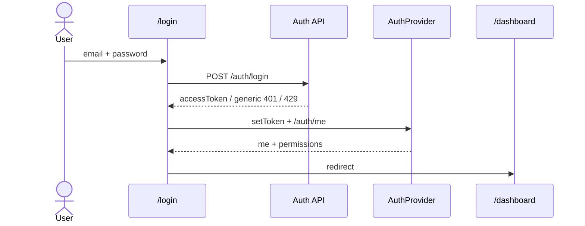
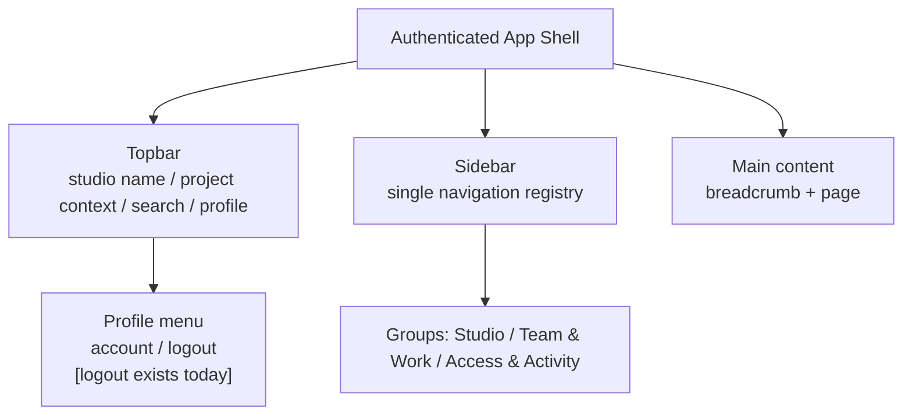

# Phase 02 — Information Architecture & User Flows

**Project:** PKL Auth System → Studio Management Platform
**Branch:** `design/studio-management-ui-ux`
**Date:** 2026-11-20
**Depends on:** `docs/ui-ux-redesign/01-ui-ux-audit.md` (approved)
**Scope:** product structure and UX planning only. No UI implementation, source, backend, schema, or dependency changes.

**Notation**

- **[VERIFIED]** — exists in the current repository source or Phase 01 audit.
- **[ASSUMPTION]** — design perspective or future workflow; not implemented and not confirmed.
- **[RECOMMENDATION]** — proposed direction for later phases.

---

## 1. Executive Summary

Phase 01 established that the current frontend is a working **RBAC administration prototype**, not a Studio Management product. The only authenticated areas today are a personal dashboard, an example Articles CRUD page, and six admin resource pages under a shared admin shell.

This phase defines the proposed product structure and the navigation paths for five studio perspectives. The central recommendation is to **keep the existing authorization foundation** and build a small, practical studio layer on top of it, rather than attempting an enterprise-scale product.

**Key decisions proposed [RECOMMENDATION]**

1. Use **one authenticated application shell** for every signed-in page, replacing the current split between `/admin` and standalone pages (Phase 01 UX-01).
2. Maintain a **single navigation registry** shared by sidebar, dashboard, and landing pages (Phase 01 UX-02, UX-03).
3. Separate **Studio Role / Discipline** from **Access Role**. The current system only models access roles.
4. Make **Projects** the primary studio object, with a minimal project list/detail in the MVP.
5. Retain existing access-management pages (users, roles, permissions, menus, delegation, audit) under one "Access & Activity" area.
6. Postpone Assets, Tasks & Workflows, advanced Settings, and any project-level authorization or multi-studio tenancy until the foundation is validated.

**Important boundary [VERIFIED]:** no project, asset, task, discipline, studio, or tenant entity exists in the current frontend or backend model. Everything described as studio-domain in this document is a proposal.

---

## 2. Product Scope and Assumptions

### 2.1 Verified current scope [VERIFIED]

- Existing routes: `/login`, `/register`, `/dashboard`, `/articles`, `/admin`, `/admin/users`, `/admin/roles`, `/admin/permissions`, `/admin/menus`, `/admin/delegations`, `/admin/audit-logs`.
- Auth is JWT-based with `{ sub }` payload; `AuthProvider` loads `/auth/me` once and exposes `has(permission)`.
- Authorization uses canonical `action:resource` permission keys and multi-role `roles[]` in the Principal.
- Seeded access roles are `superadmin` (system), `Editor`, and `Penulis` (`auth-backend/prisma/seed.ts:55-59`).
- Audit Log records admin actions with `resourceType`/`resourceId`, `before`/`after`, and filters by actor/action/resource/time.
- There is no project-level authorization and no multi-studio tenancy in the schema or API.

### 2.2 Working assumptions [ASSUMPTION]

- The target organization is an independent developer or a small game studio with a handful to a few dozen people.
- Users need a shared workspace where projects, people, and permissions are visible in one place.
- The five listed perspectives are design lenses, **not** existing roles in the database.
- Initially there is **one studio workspace**. Multi-studio support is out of scope.
- Domain concepts (project, asset, task, bug, build) will be introduced gradually and validated with the mentor.

### 2.3 Explicit non-goals for this phase [RECOMMENDATION]

- No wireframes, visual design, or component implementation.
- No API design, Prisma changes, or new endpoints.
- No decision that all eight potential areas ship in the first release.
- No assumption that existing roles map to studio disciplines.

---

## 3. User Perspectives

### 3.1 Studio Administrator

- **Responsibilities [ASSUMPTION]:** manage people, access roles, permissions, menus, delegation, and review activity.
- **Main goals:** know who has access to what; add or deactivate members; investigate important actions.
- **Information needed [VERIFIED + ASSUMPTION]:** user list, roles, permission catalog, drift report, delegation status, audit log (all exist today); plus studio member/discipline overview (missing).
- **Relevant pages / navigation [RECOMMENDATION]:** Overview → Access Management (Users, Roles, Permissions, Delegation, Menus) → Activity / Audit.
- **Expected workflow [ASSUMPTION]:** sign in → overview → open Access Management → add or edit a member → assign an access role → verify in Activity.
- **Existing support [VERIFIED]:** `/admin/users`, `/admin/roles`, `/admin/permissions`, `/admin/delegations`, `/admin/menus`, `/admin/audit-logs`; multi-role assignment; permission-aware UI.
- **Missing [ASSUMPTION]:** studio-level settings, member disciplines, project-level access scopes, onboarding invites.

### 3.2 Game Developer

- **Responsibilities [ASSUMPTION]:** implement gameplay and tools; work within assigned projects.
- **Main goals:** reach the right project quickly; see what is expected; access development workflows.
- **Information needed [ASSUMPTION]:** assigned projects, project status, tasks, build/repository links, relevant team members.
- **Relevant pages / navigation [RECOMMENDATION]:** Overview → Projects → Project detail → Tasks & Workflows (future).
- **Expected workflow [ASSUMPTION]:** sign in → overview shows "My projects" → open project → view tasks/references.
- **Existing support [VERIFIED]:** login, permission-gated dashboard, Articles page as a generic content CRUD example.
- **Missing [ASSUMPTION]:** Project entity, project membership, task list, build/repository integration.

### 3.3 Game Designer

- **Responsibilities [ASSUMPTION]:** maintain design documents, mechanics, and level/gameplay specifications.
- **Main goals:** find current design docs and share them with the project team.
- **Information needed [ASSUMPTION]:** project context, design documents, review status, version history.
- **Relevant pages / navigation [RECOMMENDATION]:** Overview → Projects → Project detail → Documents/Design notes (future).
- **Expected workflow [ASSUMPTION]:** open project → open design note → edit → mark for review.
- **Existing support [VERIFIED]:** `/articles` provides a crude create/edit/list pattern and permission keys `read:article`, `create:article`, `update:article`, `delete:article`.
- **Missing [ASSUMPTION]:** structured documents, versioning, review state, project association. The Articles page is a pattern study, not a design-document feature.

### 3.4 Artist

- **Responsibilities [ASSUMPTION]:** create and organize visual/audio assets.
- **Main goals:** upload, find, and hand off assets; understand which project they belong to.
- **Information needed [ASSUMPTION]:** asset library, thumbnails, metadata, project tags, storage/status.
- **Relevant pages / navigation [RECOMMENDATION]:** Overview → Assets → Project-tagged asset detail (future).
- **Expected workflow [ASSUMPTION]:** open Assets → filter by project → upload or open asset → attach metadata.
- **Existing support [VERIFIED]:** only generic authentication, RBAC, and menu navigation. No asset UI or API exists.
- **Missing [ASSUMPTION]:** asset entity, upload/storage, metadata, previews, ownership, project tagging.

### 3.5 QA Tester

- **Responsibilities [ASSUMPTION]:** test builds and record/triage defects.
- **Main goals:** know what to test, log reproducible bugs, see status.
- **Information needed [ASSUMPTION]:** build reference, test cases, bug list, severity/status, project context.
- **Relevant pages / navigation [RECOMMENDATION]:** Overview → Projects → Project detail → QA / Bugs (future).
- **Expected workflow [ASSUMPTION]:** open assigned project → open QA board → create bug → update status.
- **Existing support [VERIFIED]:** none specific. Audit log exists but is administrative, not a QA tool.
- **Missing [ASSUMPTION]:** bug entity, test runs, build annotations, severity/status workflow, attachments.

**Summary [VERIFIED]:** only the Studio Administrator perspective has meaningful current tooling. The other four require new domain surfaces.

---

## 4. Studio Role vs Access Role

These two concepts must remain separate in documentation, design, and future data modeling.

| Concept | Meaning | Current status | Examples |
|---|---|---|---|
| **Studio Role / Discipline** [ASSUMPTION] | What a person does in the studio; a domain attribute | **Does not exist** in current schema or UI | Programmer, Game Designer, Artist, QA Tester, Producer |
| **Access Role** [VERIFIED] | What a user may access through RBAC | Exists: `roles[]`, `permissions[]`, `isSystem` in `Principal`; seeded roles `superadmin`, `Editor`, `Penulis` | Administrator, Editor, Viewer (proposed naming); current: `superadmin`, `Editor`, `Penulis` |

**Rules [RECOMMENDATION]**

1. A person has **one discipline** (or several, if later needed) and **one or more access roles**; the two are not interchangeable.
2. Do not create an access role named "Artist" or "QA Tester" to represent a discipline. That would conflate domain identity with authorization.
3. UI labels should say "Discipline" for studio role and "Access role" for RBAC role.
4. The existing multi-role capability (`UserRole`) can support multiple access roles per person [VERIFIED].
5. Project-level authorization does **not** exist [VERIFIED]. Until it does, access roles are workspace-wide.
6. Navigation visibility must be derived from **access roles/permissions**, never from discipline.
7. Backend guards remain authoritative even if the UI hides a link (Phase 01 UX-10).

### Mermaid — concept separation



---

## 5. Proposed Information Architecture

### 5.1 Evaluation of the eight potential areas

| Area | Purpose [RECOMMENDATION] | Primary users [ASSUMPTION] | Main pages [RECOMMENDATION] | Navigation relationships | Status |
|---|---|---|---|---|---|
| **Overview** | Orientation: studio summary, my projects, quick actions | All | `/dashboard` (retain), future activity summary | Entry after login; links to Projects, Access, Activity | **Reuse existing** dashboard; enrich later [VERIFIED + RECOMMENDATION] |
| **Projects** | Primary studio object; organize work by game/project | All except maybe pure admin | `/projects`, `/projects/:id` (future) | From Overview; project detail links to Tasks/Assets/Team | **New** — required for MVP [ASSUMPTION] |
| **Assets** | Manage art/audio files and metadata | Artist, Designer, Developer | `/assets`, `/assets/:id` (future) | Cross-linked from project detail | **Postpone** beyond MVP [ASSUMPTION] |
| **Tasks & Workflows** | Track work items, review states, bugs/builds | Developer, Designer, QA | `/tasks`, `/tasks/:id`, `/qa` (future) | Under project detail; also global queue | **Postpone** beyond MVP [ASSUMPTION] |
| **Team** | People, disciplines, availability, project membership | Administrator, leads | `/team` (future; may reuse user list) | Links to Access Management for permissions | **Partial reuse** of users; discipline/membership are new [ASSUMPTION] |
| **Access Management** | Users, access roles, permissions, delegation, menus | Administrator | Existing `/admin/users`, `/admin/roles`, `/admin/permissions`, `/admin/delegations`, `/admin/menus` | Grouped under one navigation section | **Reuse + restructure** [VERIFIED] |
| **Activity / Audit** | Review administrative activity | Administrator, leads | Existing `/admin/audit-logs`; proposed label `/activity` | Linked from Overview and Access Management | **Reuse + rename** [VERIFIED + RECOMMENDATION] |
| **Settings** | Studio profile and preferences | Administrator | `/settings` (future) | Account menu / admin group | **Postpone** [ASSUMPTION] |

### 5.2 What to do with each existing page [VERIFIED + RECOMMENDATION]

| Existing page | Decision | Reason |
|---|---|---|
| `/login`, `/register` | **Retain** | Authentication works; apply shared form/label/error patterns later. |
| `/dashboard` | **Retain and restructure** as "Overview" | Currently only account data and links; become studio entry point. |
| `/articles` | **Retain but demote** from primary navigation | It is an RBAC example, not a studio domain page. Could later become Documents under a project, but that requires new data model. |
| `/admin/users` | **Retain under Access Management** | Core member/access-role management exists. |
| `/admin/roles` | **Retain under Access Management** | Role and permission assignment exists; ensure PUT replacement semantics are communicated (Phase 01 UX-18 area). |
| `/admin/permissions` | **Retain under Access Management** | Permission catalog and drift exist. |
| `/admin/menus` | **Retain under Access Management** | Menu tree exists; Phase 01 UX-15 says visibility display should be non-authoritative. |
| `/admin/delegations` | **Retain under Access Management** | Capability delegation and lineage exist. |
| `/admin/audit-logs` | **Retain; rename label to Activity / Audit** | Existing log browser; project-aware filters are future work. |

### 5.3 New pages proposed for Studio Management [ASSUMPTION / RECOMMENDATION]

- `/projects` — list of projects the user can see.
- `/projects/:id` — project overview with summary and entry points to future Tasks/Assets/Team views.
- `/team` — people directory with discipline as a future field.
- `/activity` — optional new route alias for the existing audit-log page once UX foundation allows renaming.

### 5.4 Features to postpone [RECOMMENDATION]

- Asset upload/storage and metadata.
- Task boards, sprints, reviews, bug tracking, build pipelines.
- Project-level access control and multi-studio tenancy.
- Advanced analytics, billing, public portals, real-time collaboration, native mobile apps.
- Automated invites and email notifications.

---

## 6. Sitemap and Navigation Hierarchy

### 6.1 Proposed sitemap [RECOMMENDATION]



### 6.2 Sidebar grouping [RECOMMENDATION]

```text
Studio
  Overview            /dashboard        authenticated
  Projects            /projects         future, MVP target
  Project detail      /projects/:id     future, MVP target

Team & Work
  Team                /team             future, minimal MVP
  Assets              /assets           postponed
  Tasks & Workflows   /tasks            postponed

Access & Activity
  Users               /admin/users      read:user
  Roles               /admin/roles      read:role
  Permissions         /admin/permissions read:permission
  Delegation          /admin/delegations read:delegation
  Menus               /admin/menus      read:menu
  Activity / Audit    /admin/audit-logs read:audit

Account
  Profile / Settings  future            postponed
```

**Rule [RECOMMENDATION]:** build this from one navigation registry containing label, route, required permission, group, and status (`existing` / `new` / `postponed`). This resolves Phase 01 UX-02 and UX-03.

### 6.3 Navigation visibility and authorization [VERIFIED + RECOMMENDATION]

- The UI may hide a nav item when `has(permission)` is false [VERIFIED pattern in current pages].
- Hidden navigation is **not** authorization. Backend `JwtAuthGuard` and `PermissionsGuard` remain the authority [VERIFIED].
- Do not show disabled nav items that nevertheless route to a forbidden page; either hide them or place them in a clearly labelled "No access" area.
- A user's **discipline** must never affect nav visibility [RECOMMENDATION].

---

## 7. Detailed User Flows

Each flow records the fields requested in the brief. Where a flow is future, the system response is a **proposed** behavior, not an existing API contract.

### 7.1 Login and entering the studio workspace

**Status:** mostly existing [VERIFIED]; studio context is future [ASSUMPTION].

| Field | Detail |
|---|---|
| Starting point | `/login` [VERIFIED] |
| User action | Enter email + password, submit [VERIFIED] |
| System response | `POST /auth/login`; on success store token, call `/auth/me`, populate `AuthProvider` [VERIFIED: `login/page.tsx:26-49`, `auth-context.tsx:82-105`] |
| Next destination | `/dashboard` today; proposed "Overview" after shell redesign [VERIFIED + RECOMMENDATION] |
| Required permission | None; login is public [VERIFIED] |
| Loading | Button shows "Memproses..." and is disabled [VERIFIED] |
| Empty | Not applicable |
| Success | Token stored in `localStorage`; session loaded; redirect [VERIFIED] |
| Error | Generic message for bad email/password/inactive user; 429 possible when rate limit exceeded [VERIFIED backend + UI displays `ApiError.message`] |
| Existing vs future | Existing auth flow; future addition = studio/workspace context in topbar [ASSUMPTION] |



### 7.2 Viewing the studio overview

**Status:** existing page, limited data [VERIFIED]; proposed enrichment [RECOMMENDATION].

| Field | Detail |
|---|---|
| Starting point | `/dashboard` after login or via sidebar [VERIFIED] |
| User action | Read account info, roles, permissions; click available links [VERIFIED] |
| System response | Renders `me.email`, `roles[]`, `canonicalPermissions[]`; shows admin link if any admin permission; articles link if `read:article` [VERIFIED: `dashboard/page.tsx:30-89`] |
| Next destination | `/admin` or `/articles` today; future: Projects, Team, Activity [RECOMMENDATION] |
| Required permission | Authenticated session [VERIFIED] |
| Loading | Plain "Memuat..." text [VERIFIED; Phase 01 UX-11] |
| Empty | "Belum ada role..." message when no roles [VERIFIED] |
| Success | Overview visible [VERIFIED] |
| Error | Plain red text from session error [VERIFIED] |
| Existing vs future | Existing; future overview adds studio name, my projects, recent activity [ASSUMPTION] |

### 7.3 Finding and accessing a project

**Status:** future [ASSUMPTION]. No project route or entity exists [VERIFIED].

| Field | Detail |
|---|---|
| Starting point | Overview (`/dashboard`) → "Projects" [RECOMMENDATION] |
| User action | Open Projects; search/filter by name or status; select a project [ASSUMPTION] |
| System response | Proposed: list projects visible to the user; selecting opens `/projects/:id` with summary and quick links [RECOMMENDATION] |
| Next destination | `/projects/:id` [RECOMMENDATION] |
| Required permission | Proposed: authenticated + project visibility rule; **no such rule exists today** [VERIFIED absence] |
| Loading | Proposed shared `LoadingState` [RECOMMENDATION] |
| Empty | Proposed "No projects yet" with CTA only if user can create projects [RECOMMENDATION] |
| Success | Project overview shown [ASSUMPTION] |
| Error | Proposed inline error + retry; no API behavior defined in this phase [RECOMMENDATION] |
| Existing vs future | Fully future. Current equivalent is only the global Articles list, which is not a project [VERIFIED] |

### 7.4 Managing team members

**Status:** partially existing [VERIFIED].

| Field | Detail |
|---|---|
| Starting point | `/admin/users` today; proposed `/team` [VERIFIED + RECOMMENDATION] |
| User action | Search user, open detail, create user, edit name/phone/active status, assign roles, delete [VERIFIED: `users/page.tsx`] |
| System response | Existing: API mutations + toast + list reload [VERIFIED]. Proposed Team page would also show discipline and project membership [ASSUMPTION] |
| Next destination | User detail or Access Management → Roles [VERIFIED today] |
| Required permission | `read:user`; write actions `create:user`, `update:user`, `delete:user` [VERIFIED from UI gating] |
| Loading | `LoadingState` while list loads; `busy` disables form submit [VERIFIED] |
| Empty | `EmptyState` "Belum ada user." [VERIFIED] |
| Success | Toast "User dibuat/diperbarui/dihapus" + refresh [VERIFIED] |
| Error | Per-page `handleError` maps 401/403/409; inconsistent elsewhere [VERIFIED; Phase 01 UX-09] |
| Existing vs future | Existing user CRUD and multi-role assignment; future discipline, availability, project membership, invites [ASSUMPTION] |

### 7.5 Assigning access roles

**Status:** existing [VERIFIED].

| Field | Detail |
|---|---|
| Starting point | `/admin/users` → Edit user [VERIFIED] |
| User action | Tick/untick roles in the role picker, submit [VERIFIED: `users/page.tsx:308-324, 152-155`] |
| System response | `PATCH /admin/users/:id` for profile/status then `PUT /admin/users/:id/roles` with `roleIds[]` [VERIFIED] |
| Next destination | User list with success toast [VERIFIED] |
| Required permission | `update:user` [VERIFIED] |
| Loading | Submit button disabled with "Menyimpan..." [VERIFIED] |
| Empty | If role picker is empty, user can still save `roleIds: []` [VERIFIED; design risk if unintended] |
| Success | Toast "User diperbarui" and reloaded list [VERIFIED] |
| Error | 403/409/validation shown as generic toast [VERIFIED] |
| Existing vs future | Existing RBAC assignment; future project-scoped role assignment **does not exist** [VERIFIED] |

### 7.6 Managing permissions

**Status:** existing [VERIFIED].

| Field | Detail |
|---|---|
| Starting point | `/admin/permissions` and `/admin/roles` [VERIFIED] |
| User action | Create/edit/delete permission; inspect drift; in Roles, tick permission keys and save [VERIFIED] |
| System response | API mutations; role permission update uses `PUT /admin/roles/:id/permissions` and **replaces all** permissions [VERIFIED backend behavior; Phase 01 UX-18] |
| Next destination | Same page or role list with toast [VERIFIED] |
| Required permission | `read/create/update/delete:permission`, `update:role` [VERIFIED] |
| Loading | `LoadingState` / `busy` submit state [VERIFIED] |
| Empty | Empty state text only; no CTA [VERIFIED; Phase 01 UX-24] |
| Success | Toast and list reload [VERIFIED] |
| Error | Duplicate key 409, protected/permission errors 403, drift banner [VERIFIED] |
| Existing vs future | Existing canonical `action:resource` model; future studio-specific permissions must be defined, not assumed [RECOMMENDATION] |

### 7.7 Reviewing studio activity

**Status:** existing audit browser [VERIFIED]; studio semantics are future [ASSUMPTION].

| Field | Detail |
|---|---|
| Starting point | `/admin/audit-logs` [VERIFIED] |
| User action | Filter by action/resource type/resource ID/actor/time; open detail; paginate [VERIFIED: `audit-logs/page.tsx:136-240`] |
| System response | `GET /admin/audit-logs` with query params; detail shows redacted `before`/`after` JSON [VERIFIED] |
| Next destination | Same list or detail panel [VERIFIED] |
| Required permission | `read:audit` [VERIFIED] |
| Loading | `LoadingState` [VERIFIED] |
| Empty | "Tidak ada audit log yang cocok." [VERIFIED] |
| Success | Filtered log list [VERIFIED] |
| Error | Toast; 403 specific message [VERIFIED] |
| Existing vs future | Existing activity records have `resourceType`/`resourceId`, not project context [VERIFIED]. Project-aware activity feed is future [ASSUMPTION] |

### 7.8 Cross-cutting flow rules [RECOMMENDATION]

- Every future flow should preserve list context when opening detail/edit (Phase 01 UX-04).
- Every mutation should have a single success message, one failure message, and a retry path.
- 401 should clear session centrally and return to `/login` (Phase 01 UX-10).
- Empty states should offer a CTA only when the user has the permission to act (Phase 01 UX-24).
- Navigation items shown in a flow must match backend permissions; hiding is not enforcement.

---

## 8. Existing vs Proposed Page Inventory

| Route | Status | Action |
|---|---|---|
| `/login` | Existing [VERIFIED] | Retain; improve forms/feedback later |
| `/register` | Existing [VERIFIED] | Retain; clarify "no access until role assigned" |
| `/dashboard` | Existing [VERIFIED] | Retain as **Overview**; add studio/project context later |
| `/articles` | Existing [VERIFIED] | Retain but remove from primary nav; later consider as Documents |
| `/admin` | Existing [VERIFIED] | Replace with unified Access & Activity landing or retire once sidebar exists |
| `/admin/users` | Existing [VERIFIED] | Retain under Access Management |
| `/admin/roles` | Existing [VERIFIED] | Retain under Access Management |
| `/admin/permissions` | Existing [VERIFIED] | Retain under Access Management |
| `/admin/menus` | Existing [VERIFIED] | Retain under Access Management |
| `/admin/delegations` | Existing [VERIFIED] | Retain under Access Management |
| `/admin/audit-logs` | Existing [VERIFIED] | Retain; relabel Activity / Audit |
| `/projects`, `/projects/:id` | Proposed [ASSUMPTION] | New in MVP |
| `/team` | Proposed [ASSUMPTION] | New minimal in MVP |
| `/assets`, `/assets/:id` | Proposed [ASSUMPTION] | Postpone |
| `/tasks`, `/tasks/:id`, `/qa` | Proposed [ASSUMPTION] | Postpone |
| `/activity` | Proposed alias [RECOMMENDATION] | Optional rename of audit route after foundation |
| `/settings` | Proposed [ASSUMPTION] | Postpone |

---

## 9. Global Application Shell

### 9.1 Recommendation [RECOMMENDATION]

Replace the two-shell model identified in Phase 01 UX-01 with one authenticated shell used by `/dashboard`, `/projects`, `/team`, `/articles`, and all admin/access pages.



### 9.2 Sidebar organization [RECOMMENDATION]

- Use the groups defined in §6.2.
- Show **new** sections as available only once their first real page exists; do not show placeholder links.
- Merge dynamic menu data with the static registry instead of replacing one with the other (Phase 01 UX-03).
- Keep active-state styling from the current `Sidebar.tsx` [VERIFIED].

### 9.3 Topbar responsibilities [RECOMMENDATION]

- Studio/workspace name (single workspace initially).
- Project context selector once Projects exist [ASSUMPTION].
- Global search entry point (postponed beyond MVP).
- Profile/account menu with logout [VERIFIED logout exists in `AuthProvider` and admin header].
- Avoid duplicating page-level primary actions in the topbar.

### 9.4 Breadcrumb behavior [RECOMMENDATION]

- Derive breadcrumbs from the same navigation registry.
- Pattern: `Studio / Projects / Project name`.
- For admin pages: `Studio / Access Management / Users`.
- Breadcrumbs are orientation only, not authorization (Phase 01 UX-22).

### 9.5 Workspace / project context [ASSUMPTION + RECOMMENDATION]

- Initially there is one implicit workspace; no tenant selector.
- Once Projects exist, a project context should affect content and breadcrumbs, not access rights by itself.
- Project-level permissions are **not** available today; do not design UI that implies they exist.

### 9.6 Profile and account menu [RECOMMENDATION]

- Show name/username, email, access roles, and logout.
- Do not show discipline until the domain field exists [ASSUMPTION].
- Keep account settings out of MVP.

### 9.7 Responsive navigation [VERIFIED + RECOMMENDATION]

- Keep the current mobile sidebar toggle pattern as the base [VERIFIED: `AppShell.tsx:25-32, 46-57`].
- On small screens, default the sidebar closed; show breadcrumb/truncated project context in topbar.
- Tables should scroll horizontally rather than reflow into unreadable cards in MVP.

---

## 10. MVP and Future Scope

### 10.1 A. Existing foundation to retain [VERIFIED]

- JWT login, `/auth/me`, `AuthProvider`, `has()`.
- Canonical `action:resource` permissions and multi-role access model.
- API wrapper with `ApiError` and typed responses.
- User/role/permission/menu/delegation/audit pages.
- Shared primitives: `Toast`, `ConfirmDialog`, `Pagination`, `LoadingState`, `EmptyState`.
- Backend-enforced authorization and protected superadmin rules.

### 10.2 B. Minimum Studio Management experience [RECOMMENDATION + ASSUMPTION]

Realistic for an independent developer or small studio:

1. One authenticated shell with unified navigation (foundation from Phase 01 Phase 1).
2. **Overview** that shows identity, access roles, and a simple "My projects" section.
3. **Projects** list + minimal project detail (name, description, status, members summary).
4. **Team** view that reuses user data, with discipline left as a future/placeholder field only if explicitly marked.
5. **Access Management** grouping existing RBAC pages, with clear permission replacement behavior.
6. **Activity / Audit** using the existing log browser.

Minimum domain need: a Project entity and a way to associate people with projects. Both require future backend work; this phase only defines the UX need.

### 10.3 C. Later enhancements [ASSUMPTION / RECOMMENDATION]

- Assets library and file metadata.
- Tasks, reviews, bugs, builds.
- Project-level access control and multi-studio tenancy.
- Advanced settings, notifications, invitations, analytics.
- Rich activity feed with project filters.
- Document/version management replacing the generic Articles example.

---

## 11. UX Decisions and Open Questions

### 11.1 Proposed UX decisions [RECOMMENDATION]

| Decision | Choice | Rationale |
|---|---|---|
| Primary workspace model | Single studio initially | Matches small-team scope; avoids tenancy complexity |
| Primary object | Project | Gives Developers/Designers/QA a natural anchor |
| Navigation source | One registry | Fixes Phase 01 UX-02/UX-03 |
| Discipline vs access | Separate concepts | Prevents conflating job title with permission |
| Initial nav groups | Studio / Team & Work / Access & Activity | Maps to verified and planned areas without overbuilding |
| Shell | One authenticated shell | Fixes Phase 01 UX-01 |
| Authorization source | Backend remains authoritative | Existing guards verified; UI visibility is hint only |

### 11.2 Open questions for mentor review [ASSUMPTION]

1. Should the product be called a "studio workspace" or simply "workspace"?
2. Is one studio workspace sufficient for the PKL scope, or is multi-studio required later?
3. Which access-role naming should be used in UI: current `superadmin`/`Editor`/`Penulis`, or proposed Administrator/Editor/Viewer?
4. Should disciplines be free text, predefined list, or omitted in MVP?
5. Who may create a project — Administrator only, or any member with a specific permission?
6. Is project membership needed in MVP, or is a global team list enough?
7. Should `/articles` be kept as a sample, renamed to Documents, or removed from primary navigation?
8. Should Activity Log include project context? If yes, backend logging must change later.
9. Is localStorage acceptable for the prototype, or should session storage be revisited before UI foundation work?
10. Should dark mode be supported properly or removed?

**Rule:** any unresolved question must remain documented as an assumption; do not encode it as an implemented behavior.

---

## 12. Recommendations for Phase 03

Phase 03 should translate this IA into concrete design artifacts without implementing code:

1. **Navigation registry specification** — route, label, group, required permission, status, icon placeholder, and visibility rule.
2. **Shell wireframes** — desktop and mobile versions of the authenticated shell, topbar, sidebar, breadcrumb, and profile menu.
3. **Page templates** — list page, detail page, form drawer/modal, empty/loading/error states, based on Phase 01 findings UX-04/05/06/07/11.
4. **Overview and Projects wireframes** — the only new domain screens in MVP.
5. **Access & Activity wireframes** — restructure existing pages into the new grouping without changing backend behavior.
6. **Discipline vs access-role visual language** — labels, badges, and help text that keep the two concepts distinct.
7. **Validation plan** — confirm the five perspective assumptions and the open questions with the mentor before design freeze.
8. **Traceability matrix** — map each Phase 01 finding ID to the Phase 03 artifact that addresses it.

**No implementation should begin until the IA, role distinction, and MVP boundary are reviewed and accepted.**

---

**STOP — Phase 02 complete. Awaiting review before Phase 03 wireframes/design.**
